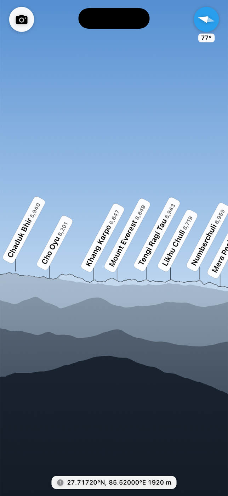
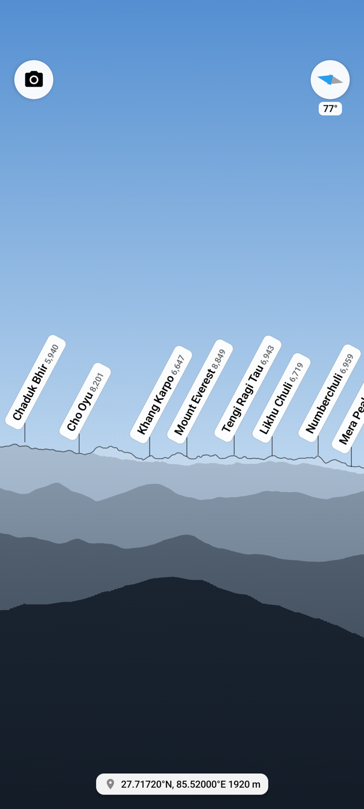
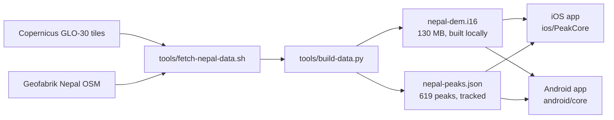
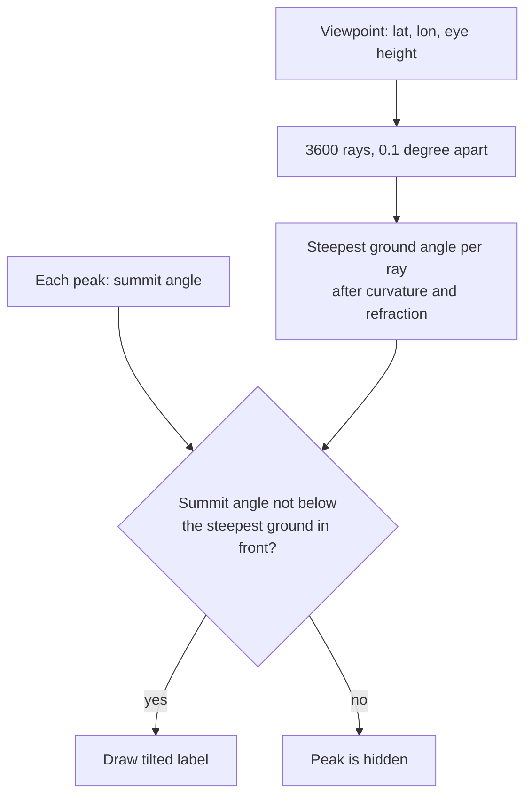

# Himal

A Nepal-only app that names the peaks around you. It draws a flat panorama of the ridges with a tilted label on each peak. A camera mode puts the same labels over the live camera. It works offline.

The idea comes from the PeakFinder app. Himal is a personal build, sideloaded to one phone. It is not for any app store.

| iOS | Android |
|---|---|
|  |  |

Same viewpoint on both: Nagarkot, heading 77 degrees, Mount Everest in view.

## How it works

- Terrain is packed at 3 arc-seconds (about 90 m). Each cell keeps the highest source cell, so summits survive.
- Peaks are OSM `natural=peak` points with a Latin or Devanagari name. A peak with no numeric `ele` tag takes its height from the terrain data.
- Both engines follow the same rules, and both test suites check the same facts.

## Folders

| Folder | Holds |
|---|---|
| `ios/` | iOS app (SwiftUI) and `ios/PeakCore`, the Swift engine package. |
| `android/` | Android app (Kotlin, Compose). `android/core` is the engine. |
| `shared/data/` | Packed peaks and terrain header, bundled by both apps. |
| `tools/` | Scripts that fetch and pack the data and take screenshots. |
| `docs/images/` | The screenshots above. |

## Setup

Requirements: macOS 14 or newer, `brew install osmium-tool xcodegen uv`, Xcode 16 or newer, JDK 17 (set `JAVA_HOME`), and the Android SDK (set `ANDROID_HOME`, or put `sdk.dir` in `android/local.properties`).

1. `tools/fetch-nepal-data.sh` downloads about 2.1 GB (1.7 GB terrain, the rest OSM) to `../peakfinder-data` and cuts the peaks. The tracked `nepal-peaks.json` is a 619-peak snapshot. A rebuild from the latest extract can differ.
2. `uv run tools/build-data.py` writes the packed files to `shared/data`.
3. iOS: change `bundleIdPrefix` and `PRODUCT_BUNDLE_IDENTIFIER` in `ios/project.yml` to an id you own. Run `xcodegen generate` in `ios`, open `ios/Himal.xcodeproj`, pick your Apple ID under Signing, and run on the phone. Each `xcodegen generate` clears the Signing choice. A free Apple ID expires the app after 7 days.
4. Android: in `android`, run `./gradlew :app:assembleRelease`, then `adb install -r app/build/outputs/apk/release/app-release.apk`. The release build uses the debug key, so it is for sideloading only.

## Test

| Target | Command |
|---|---|
| iOS engine | `swift test` in `ios/PeakCore` |
| Android engine | `./gradlew :core:test` in `android` (JVM only, no emulator) |
| iOS screen | `tools/ios-sim-shot.sh OUT.png -lat 27.7172 -lon 85.52 -heading 77` |
| Android screen | `tools/android-shot.sh OUT.png --ed lat 27.7172 --ed lon 85.52 --ed heading 77` |

- The Nepal sightline tests skip when the packed terrain is missing.
- The iOS screen script builds for an `iPhone 17 Pro` simulator and uses the id `com.shanpanta.himal`. Edit the `-destination` and the id in the script if you use another simulator or changed the id.
- The Android screen script uses the device in `adb devices`.

## Not verified yet

- Live compass and camera alignment on a real phone. Simulators and emulators only fake them.
- Landscape layout and pinch to zoom.
- Accuracy against a real photo.

## Limits

- Only 619 named peaks. OSM has no English name for most Nepali peaks.
- The terrain model includes roofs and trees. Ground less than 25 m above the eye within 2 km is ignored.
- Bearings use a sphere, which is up to 0.15 degrees off the WGS84 geodesic.

## Data credits

- Contains data (c) OpenStreetMap contributors, available under the Open Database Licence (ODbL).
- Contains Copernicus DEM GLO-30, produced using Copernicus WorldDEM-30 (c) DLR e.V. 2010-2014 and (c) Airbus Defence and Space GmbH 2014-2018, provided under COPERNICUS by the European Union and ESA. All rights reserved.
- Full notices: `shared/data/NOTICE`.

## Decisions

- Native Swift, not a web page.
- Own build kept after the prior art search. UI follows PeakFinder, ideas come from Peak.
- iOS pitch and roll use gravity, not the attitude matrix. Apple documents the matrix frame in conflicting ways.
- Android is native Kotlin, not Expo. A JavaScript engine without a JIT ran 28 times slower than V8 with one on the same loop, and the terrain file is 130 MB.
